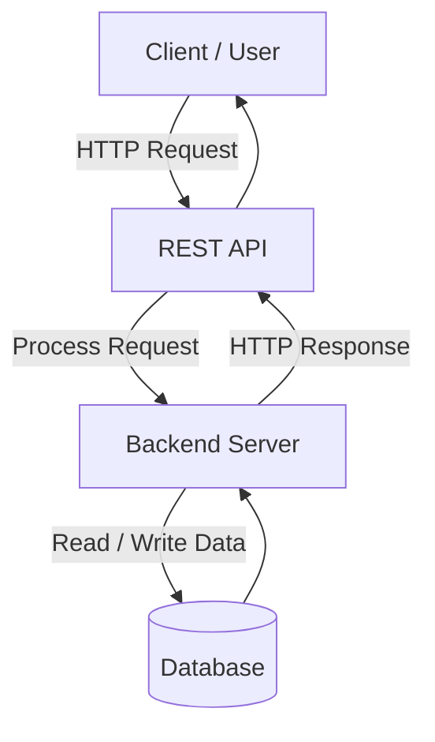

# System Architecture Diagram

## Student Task Management System

## Architecture Description

- Client sends requests to the API.
- REST API receives and processes requests.
- Backend Server handles business logic.
- Database stores Users and Tasks data.
- Server sends responses back to the Client.
